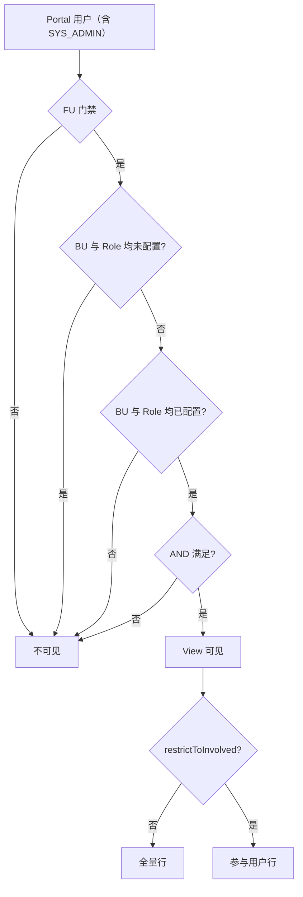

# View 访问管控 — 业务规则与实现契约

**System Administrator** = 平台角色码 `SYS_ADMIN`（种子数据名「System Administrator」）。

> 目标规则来源：[平台访问模型 PRD](../../../docs/design/platform-access-model-requirements.md) §7（D-04、D-05，2026-10-29 确认）。
> **Portal 里没有 SYS_ADMIN 特权。** SYS_ADMIN 必须是某个 CUSTOM 虚拟组成员才能进 Portal，进入后与普通用户一样，只按**当前 BU + Role（UBR）**判断。
> Portal 的 SYS_ADMIN 旁路已在平台访问模型 WP8a（2026-11-01）删除；剩余项见文末「与现有实现的差距」。

## 核心规则（必须遵守）

### 1. View 可见性（Portal 菜单 / listPublishedViews）

规则对**所有用户**相同，含 SYS_ADMIN。

| 条件 | 所有用户（含 SYS_ADMIN） |
|------|--------------------------|
| View **未配置任何 BU 且未配置任何 Role** | **不可见**（发布后无人能看到） |
| View **只配置了 BU 或只配置了 Role**（不完整） | **不可见** |
| View **同时配置了 BU 与 Role** | 须 **AND** 匹配（见下） |
| 前提 | 先通过 FU 级门禁，再受 View 规则约束 |

**成对配置（DW Save 校验 + Portal 运行时）：**

- BU 与 Role **必须同时出现**：要么 **两者均空**（无人可见），要么 **两者均有至少一项**。
- 两者均空时 DW Save 须提示“发布后没有人能看到此 View”（不拦截）。
- ❌ 禁止仅配 BU、仅配 Role、或 Save 时只填一侧。
- ✅ DW Role 下拉须按 **已选 BU** 调用 `GET /business-units/{id}/roles`（准入角色），**禁止**用全局 `/roles`（常为空）。

**AND 语义（两维均已配置时），只看当前工作区（会话里的 BU + Role 这一对）：**

- 当前 BU 须是已选 BU 列表中的 **一个**。
- 当前 Role 须是已选 Role 列表中的 **一个**。
- **两维须同时满足**；不把用户不同 UBR 的 BU 与 Role 拼成一个不存在的组合（持有 BU1+R1、BU2+R2 不匹配规则 BU1+R2）。没有当前组合（权限自助模式）什么都看不到。

**与旧文案的区别（禁止再写错）：**

- ❌ 「BU 与 Role 均未配置时，仅 System Administrator 可见」—— 已废弃；现在是**无人可见**。
- ❌ 「SYS_ADMIN 看全部 View / 全部行数据」—— 已废弃。
- ❌ 「未选 BU/Role 表示该维度不限制」—— 两维都空 = 无人可见；只配一维 = **不可见**。
- ❌ 「只配置 BU 时 Role 不限制」—— 已废弃。
- ✅ 「BU 与 Role 均未配置时，发布后任何人都看不到；若配置访问控制，须 **成对** 选择 BU 与 Role。」

### 2. System Administrator 没有特权

`SYS_ADMIN` 在 Portal：

1. **不**看见全部 View：与普通用户同样按 §1 过滤。
2. **不**看见全部行数据：View 开启 `restrictToInvolvedUsers` 时同样只看自己参与的行。
3. **不**绕过 FU 级门禁：`sys_function_unit_access` 对 SYS_ADMIN 同样生效。

禁止在 Resolver / Service / Component 入口写 `if (isSystemAdministrator(userId)) return true;` 一类短路。
SYS_ADMIN 需要业务数据时，和其他人一样在 Portal 申请对应 BU + Role。

### 3. 数据范围（所有用户）

| `restrictToInvolvedUsers` | 行数据 |
|---------------------------|--------|
| `false` | FU 内该 View 对应表的全量行 |
| `true` | 仅 **发起人 + 历史/当前 assignee + MI 子表参与者** 相关行 |

实现：`PortalMainTableViewServiceImpl.loadAndProjectRows` + `MainTableViewInvolvementChecker`；**入口不按角色短路**。

---

## 决策流程



---

## 代码 touchpoints

| 层 | 文件 | 职责 |
|----|------|------|
| Portal 可见性 | `backend/user-portal/.../MainTableViewAccessResolver.java` | 空规则 / 不完整规则 → `false`；完整规则 AND；不按角色短路 |
| Portal 列表/数据 | `backend/user-portal/.../PortalMainTableViewServiceImpl.java` | 过滤 View；involvement 过滤对所有用户生效 |
| Portal FU 门禁 | `backend/user-portal/.../FunctionUnitAccessComponent.java` | 不按角色旁路；**code → catalog UUID** 后再查 access |
| DW 设计态 | `MainTableViewServiceImpl.validateAccessRules` + `useMainTableViewDesigner.ts` + i18n ×3 | 成对校验；两者均空时提示无人可见；Role 按 BU 准入列表加载 |
| Schema | `deploy/init-scripts/00-schema/51-dw-main-table-view-access.sql` | `dw_main_table_view_access` + `restrict_to_involved_users` |
| 测试种子 | `deploy/init-scripts/91-view-access-test/01-view-access-test-users.sql` | `view_*` 账号；`view_admin` 须在 CUSTOM 组且有 UBR，按 UBR 判断 |
| 单测 | `MainTableViewAccessResolverTest`、`FunctionUnitAccessComponentTest`、`MainTableViewServiceImplTest`（access 成对） | 空/不完整/AND；SYS_ADMIN 无旁路；FU code resolve；DW Save 校验 |

---

## 实现要点（Resolver 伪代码）

```java
// 不按 SYS_ADMIN 短路
Set<String> buIds = ... BUSINESS_UNIT ...
Set<String> roleIds = ... ROLE ...

if (buIds.isEmpty() && roleIds.isEmpty()) return false; // 无人可见
if (buIds.isEmpty() || roleIds.isEmpty()) return false; // 不完整配置

// 只看会话里的当前 BU + Role（activeBusinessUnitId / activeRoleId），规则存 id
return activeBu != null && activeRole != null && buIds.contains(activeBu) && roleIds.contains(activeRole);
```

DW Save 校验：

```java
if (!buIds.isEmpty() || !roleIds.isEmpty()) {
  if (buIds.isEmpty() || roleIds.isEmpty())
    throw BIZ_VIEW_ACCESS_BU_ROLE_PAIR;
}
// 两者均空：允许保存，前端提示发布后无人可见
```

DW Role 选项（前端）：

```typescript
// 已选 BU 变更 → Promise.all(buIds.map(id => getBusinessUnitEligibleRoles(id)))
// Role 下拉 disabled 直到至少选一个 BU
```

Portal FU 门禁：

```java
// canAccessFunctionUnit → resolveFunctionUnitId(code) 后再 GET .../access；不调用 isSystemAdministrator
```

测试账号：`view_admin` 须 **CUSTOM 组成员 + UBR**；只有 SYS_ADMIN、没有 CUSTOM → 不能进 Portal；有 CUSTOM 无 UBR → 权限自助模式。

---

## DW UI 文案（三语同步）

`mainTableView.accessControlHint` + `accessControlBuRoleRequired` + `rolesSelectBuFirst` + `savedWithoutAccess`（两边都空时保存后的警告）。
`accessControlHint` 须写“均未配置时发布后任何人都看不到”，不得再写“仅 System Administrator 可见”。

---

## 测试矩阵（改规则必跑）

| # | 用户 | View BU/Role | 期望 |
|---|------|--------------|------|
| T1 | SYS_ADMIN（CUSTOM + 无匹配 UBR） | 空 | **不可见** View |
| T2 | 普通用户 | 空 | **不可见** View |
| T3 | 用户 A（BU-1 + Role-X） | BU-1 + Role-X | 可见 |
| T4 | 用户 A | BU-1 + Role-Y | 不可见 |
| T5 | 任意用户 | **仅 BU 或仅 Role** | **不可见** |
| T6 | 普通用户 | BU+Role + restrictToInvolved=true | 仅参与行 |
| T7 | SYS_ADMIN（有匹配 UBR） | BU+Role + restrictToInvolved=true | **仅参与行** |
| T8 | SYS_ADMIN（CUSTOM + 无 FU access 的 UBR） | 任意 | FU 门禁拒绝，View 不可见 |
| T9 | 持有 BU-1+Role-X 与 BU-2+Role-Y 的用户 | BU-1 + Role-Y | 两个工作区都 **不可见**（不拼合） |
| DW | 设计者 | 只选 BU 点 Save | **拒绝**，提示成对必填 |
| DW | 设计者 | BU、Role 都不选点 Save | 保存成功，提示发布后无人可见 |
| DW | 设计者 | 选 BU 后 | Role 下拉显示该 BU **准入角色** |

单测：`MainTableViewAccessResolverTest`、`FunctionUnitAccessComponentTest`、`MainTableViewServiceImplTest`；手测：`docs/view-access-control-test-guide.md`；E2E：`node scripts/verify-view-access-control.mjs`。

---

## 与现有实现的差距（改动前自检）

落地后应全部为 ✅：

- [x] `canUserSeeView`：不完整配置（仅 BU / 仅 Role）→ `false`
- [x] `MainTableViewServiceImpl.validateAccessRules`：Save 成对校验
- [x] DW：`getBusinessUnitEligibleRoles` 加载 Role；Save 前端校验
- [x] Export/Import/Clone：`MainTableViewPortability` JDBC 导出 access + 成对校验（见 `function-unit-portability` skill）
- [x] `canUserSeeView`：删除 SYS_ADMIN 短路（空配置对 SYS_ADMIN 也 `false`）
- [x] `loadAndProjectRows`：删除“SYS_ADMIN 跳过 `restrictToInvolvedUsers`”
- [x] `canAccessFunctionUnit`：删除 SYS_ADMIN bypass（FU code 先 resolve 再查 access 保留）
- [x] `isSystemAdministrator`（`profileContext=ADMIN`）：View / FU 门禁不再调用，Portal 内已无调用方
- [x] DW：BU、Role 均空 Save 时提示“发布后无人可见”（`mainTableView.savedWithoutAccess`，警告样式，不拦截）
- [x] i18n ×3：`accessControlHint` 去掉“仅 System Administrator 可见”；帮助站 `frontend/help` 文案与 `public/guides/dw-view-design.png` 已同步
- [ ] 测试种子：`91-view-access-test` 种子已在 a46995e9b 删除，dev 库无 `view_*` 账号；重建时 `view_admin` 加入 CUSTOM 组，按 UBR 验证（T1、T7、T8）
- [x] 单测（`MainTableViewAccessResolverTest`、`FunctionUnitAccessComponentTest` 等）与 `docs/view-access-control-test-guide.md` 按新矩阵改
- [ ] `frontend/scripts/verify-view-access-control.mjs` 的 `view_admin` 期望随种子重建一起改

---

## FU 导入 / 导出 / Clone

View access 与 `restrictToInvolvedUsers` MUST 随 FU 包走完整 round-trip。详见 **`.cursor/skills/function-unit-portability/SKILL.md`**：

- Export：`views/main_table_views.json`（`targetCode` + `targetId`，JDBC 读 access）
- Import / 版本回滚：`MainTableViewPortability.importAll` + 成对校验
- Clone：`cloneViewsForFunctionUnit` + 成对校验
- Publish：`validateAccessRules` on `publishViewsForFunctionUnit`

---

## 参考

- 目标规则：`docs/design/platform-access-model-requirements.md` §7
- 手测指南：`docs/view-access-control-test-guide.md`
- 测试种子：`deploy/init-scripts/91-view-access-test/01-view-access-test-users.sql`
- FU 可移植性清单：`.cursor/skills/function-unit-portability/SKILL.md`
- Portal MI 数据语义（View 场景勿混用）：`.cursor/rules/portal-mi-subtable-my-request.mdc`
