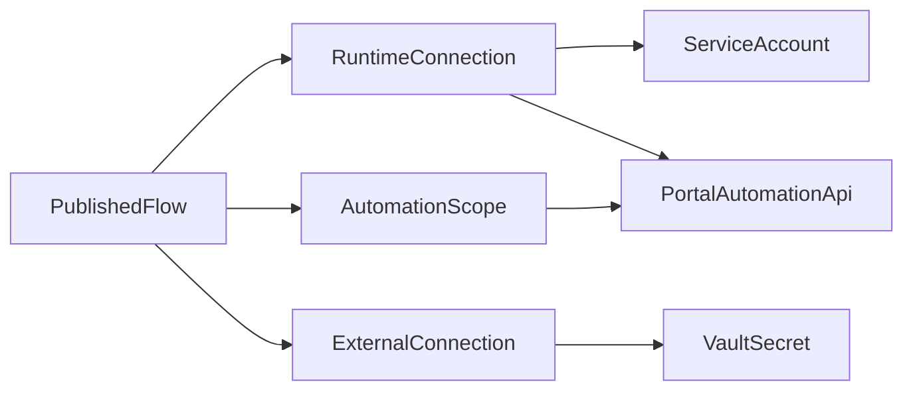
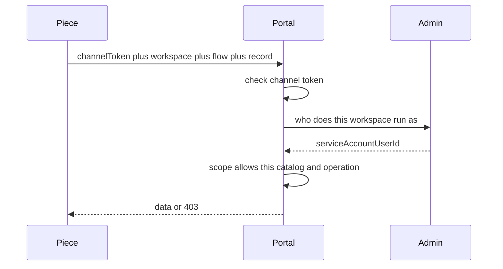

# Automation Connection 与数据安全

设计依据：Connection 讨论与「当作所有的都没有做」的从零方案。推荐 MVP 为方案 A（发布时 Scope + 长期 automation 通道密钥）。方案 B（短效 Run Token）只作为后续硬化，不进 MVP。

## 背景

Developer Workstation 的 Automation（嵌入的 Activepieces）会在没有登录用户的情况下跑流程：Webhook、Timer、设计器 Test。这些步骤会读写信函级 Function Unit 数据、发邮件、调外部 HTTP。

把 Connection 做成「凭证 + 连接所有者权限」会同时带来三类问题：审计记错人、共享流程等于共享邮箱或个人权限、任意流程只要拿到平台调用能力就能按实例 ID 横向读写信函。

身份（以谁执行）和授权（能碰哪些数据）必须分开。外部系统密码必须留在服务端，不能出现在流程 JSON、步骤输入或 webhook 响应里。

## 目标

- 每个 Automation 工作区绑定唯一运行身份（Runtime Connection）。Timer、Webhook、设计器 Test 都以该服务账号读写，变更历史记该账号。步骤里不能选同事，也不能填自由文本 actor。
- 每个已发布 flow 冻结一份数据范围（Automation Scope）：发布时显式选出的一个 Function Unit，以及读/写/子表/Query。运行时由门户内部 API 只读这份快照，编辑者不能临时放大。
- 外部凭证（External Connection）与运行身份分离。流程只保存引用名，密码走 Vault。
- Activepieces 不持有 admin 的 `SERVICE_INTERNAL_TOKEN`。门户 automation 通道密钥只证明「调用方是自动化引擎」，不决定操作人，也不代替数据授权。
- 环境变量查询只返回 TEXT。不返回 VAULT 密码或 connection secret。

## 非目标

- 环境变量类型 CONNECTION，以及 webhook 把 secret 返回给调用方。
- 步骤字段 Triggered by，或在步骤里选择平台用户当 actor。
- 未绑定时，把当前流程编辑者的个人账号隐式当成 Timer 身份。工作区仍可显式绑定任意已存在的系统账号。
- 把服务账号挂到 `dw_email_connections`。邮箱连接仍是 Function Unit 级、只存 Vault 路径（现有 [EmailConnection.java](../../backend/admin-center/src/main/java/com/admin/entity/EmailConnection.java) 的 `passwordEnvKey`）。
- 本轮做邮件步骤的连接选择器。
- 改 MI 子表语义，或新造一套 BU 权限模型。
- MVP 实现短效 Run Token。

## 两类 Connection

- Runtime Connection：工作区默认账号，发布单条流程时可以另选已登记账号。空则用工作区默认，再没有则用平台默认。能在该工作区发布自动化的人可以配置。Public 工作区仅系统管理员。流程步骤只显示说明，没有输入框。已写过的变更历史不改。
- Automation Scope：已发布 flow 的快照。发布人必须显式选出恰好一个 Function Unit，且该 Function Unit 必须已分配给本 flow 所在开发组（与 Developer Workstation 工作区访问同一归属，不另造规则）。catalog 只含这一个；能力（读、Query、写主表、写子表）可以在这个 Function Unit 内收紧。仓库里 flow 与 Function Unit 是 BPMN 引用关系，一个 flow 可被多个 Function Unit 引用，没有「所属 Function Unit」列，因此不能从引用关系倒推范围。其它 Function Unit 引用同一 flow 不扩大数据范围，也不能把别的开发组的 Function Unit 选进 Scope。一个 flow 授权多个 Function Unit 不在本轮。运行时只读这份快照，不能放大。
- External Connection：邮箱或第三方 API。流程里只有引用名。解析只发生在发信或出站 HTTP 的服务端。

## 校验发生在哪里

两处，查的不是同一件事。Activepieces 触发流程时不查 Scope，流程可以先跑起来；失败发生在碰到数据的那一步。

- **发布时（写约束）**：发布 Automation 时调用 Scope 写入接口。接口只接受发布人选出的那一个 Function Unit 的 catalog，能力可以收紧，不能改去碰别的 Function Unit。没选出 Function Unit 则这次写入失败，不生成快照。
- **每次数据请求（读快照）**：校验做在门户内部记录 API 里，不是做在 Activepieces 触发内核里。Function Unit Data 的每一次读、Query、写主表、写子表都打这些接口；设计器 Test、Timer、Webhook 走同一条路径。门户用请求里的 `flowId` 读已发布快照，核对目标 catalog 和本次操作。没有快照、catalog 不对或能力不够则 403，不读写。

## 运行时校验顺序

门户内部记录 API 每次按这个顺序，缺一即拒绝，不降级成「匿名可读」：

1. 校验 automation 通道密钥（调用方是引擎，不是浏览器用户）。
2. 用 Activepieces 项目外部 ID 解析工作区，再解析 Runtime Connection 上的服务账号。未绑定则用环境级平台默认服务账号。
3. 用 flow 标识查出已发布 Scope，确认目标 catalog 与操作（读、Query、写主表、写子表）都在范围内。
4. 执行读写。写操作的变更历史 `userId` 只能是第 2 步解析出的服务账号，忽略客户端传来的任何人名。该账号的角色、能否登录、是否 `SYS_ADMIN` 都不参与放行。

## 方案

- 方案 A（MVP）：长期 automation 通道密钥仍然只证明引擎身份。门户提供一组内部记录 API，每次请求带工作区外部 ID 和 flow 标识，先解析运行身份再校验已发布 Scope。没有 Scope 或不匹配则 403。本地已有的未提交实现不作为本契约。
- 方案 B（后续）：每次运行签发短 TTL、带 catalog 与读写声明的 Run Token。Piece 只认 Run Token。长期密钥只用于换票。
- 方案 C（不单独采用）：只给服务账号配角色、走普通用户权限。挡不住「知道实例 ID 就读」和 Query 扫表。

推荐 A。理由：改动集中在 admin-center、user-portal、发布门禁和 Function Unit Data piece，不改 Activepieces 触发内核。C-3 保持不变：AP 仍不持有 `SERVICE_INTERNAL_TOKEN`（见 [DECISIONS.md](DECISIONS.md)）。

## 数据

新增脚本只追加到 `deploy/init-scripts/00-schema/`，不改历史脚本。表前缀 `ac_`。

- `ac_service_accounts`：`user_id`、`display_name`、`platform_default`。对应 `sys_users` 里任意一行已存在的账号。不要求 INACTIVE，不要求不可登录，不看角色码，也不禁止 `SYS_ADMIN`。平台默认账号只是其中 `platform_default` 的那一行。
- `ac_automation_runtime_connection`：`workspace_id` 主键，`service_account_user_id`。没有行表示用平台默认账号。
- `ac_automation_flow_scope`：已发布 flow 的快照，按 flow 一份，不按工作区一份。`flow_id`、`workspace_id`、发布时选出的那一个 Function Unit 及其 catalog id、能力（read、query、write、subtable）。重新发布覆盖该 flow 的快照，不改历史已跑完的实例。

工作区就是 DW 开发组，不是 BU。Public 为 `hermes-main`，团队为 `hermes-dg-` 加开发组 ID。Runtime Connection 绑在这个工作区上。BU 继续只管门户的人与可见范围，不作为运行身份的绑定键。

## 要提供的 API

本地未提交代码不计入。下面是本 Plan 要交付的契约。成功体用 `ApiResponse`（`code` / `message` / `data`）。管理面失败同样走统一错误体。不提供「传入用户名当作操作人」的字段，不提供把 VAULT 或 connection 密码返回给调用方的接口。

调用关系：

- Developer Workstation 浏览器（登录 cookie）调用 admin 管理面。
- user-portal 用 `X-Service-Token`（`SERVICE_INTERNAL_TOKEN`）调用 admin 内部接口。Activepieces 不持有该密钥，不能直接调 admin。
- Function Unit Data piece 用 `X-Internal-Token`（`PORTAL_INTERNAL_API_TOKEN`）调用门户内部接口。该密钥只证明调用方是自动化引擎。

上下文路径：admin 为 `/api/v1/admin`，门户为 `/api/portal`。

### Admin 管理面（登录用户）

绑定规则：未登录 401。`__ALL__` 与空工作区拒绝。绑定与发布同一道门：`ApWorkspaceResolver` 的 `canWrite`。Public 工作区仅 `SYS_ADMIN`。其他工作区必须存在且为 ACTIVE；绑定人是 `SYS_ADMIN`，或是该组成员且角色为 `DEVELOPER`、`TECH_LEAD` 或 `TEAM_LEAD`。登记新服务账号仍仅 `SYS_ADMIN`。目标用户必须已经在 `ac_service_accounts`。能绑定的人可以列出已登记账号。响应只含 userId 与 displayName，不含密码或 token。

- `GET /automation-service-accounts`：可绑定的服务账号列表。请求头 `X-Dev-Group-Id`。与该工作区的发布权限相同：能发布才能列出。Public 仅 `SYS_ADMIN`。
- `POST /automation-service-accounts`：把一个已存在于 `sys_users` 的账号登记为服务账号。请求头 `X-Dev-Group-Id`。与该工作区的发布权限相同。Public 仅 `SYS_ADMIN`。不校验该账号的角色、状态或能否登录。请求体 `userId`、`displayName`、可选 `platformDefault`。显式 `platformDefault=true` 仍仅 `SYS_ADMIN`。未传时再次登记只更新显示名，不改掉已有的平台默认。`userId` 在系统中不存在则拒绝。环境里最多一个 platform default。
- `GET /automation-runtime-connections/{workspaceId}`：当前绑定。没有绑定行时 `data` 标明使用平台默认账号（含其 userId 与 displayName）。
- `PUT /automation-runtime-connections/{workspaceId}`：绑定。请求体 `serviceAccountUserId`。
- `DELETE /automation-runtime-connections/{workspaceId}`：解除绑定，之后运行身份回到平台默认账号。权限与 PUT 相同。
- `GET /automation/flows/{flowId}/scope`：读取该 flow 已发布的 Scope（catalog 列表与能力）。
- `PUT /automation/flows/{flowId}/scope`：发布或更新 Scope。请求体必须带选出的一个 `functionUnitId`，以及 `catalogIds`、`capabilities`（`read`、`query`、`write`、`subtable`）。调用者必须有权发布该 flow 所在工作区。`functionUnitId` 必须已分配给该开发组；未分配或属于其他开发组则拒绝。`catalogIds` 只能是该 Function Unit 的 catalog，不能改成任意 catalog，也不能一次写入多个 Function Unit。未选 Function Unit 则拒绝，不生成快照。重新发布覆盖该 flow 的快照。Query 留在本轮：运行时仍须 Scope 打开 `query`、至少一条主表白名单字段 filter、`size` 上限 50。同一 Function Unit 内不按人、不按 BU 再切行。

### Admin 内部（仅门户，X-Service-Token）

错误令牌 403。无法识别的外部项目 ID 403。平台默认账号未配置时 503。响应不含密钥。

- `GET /internal/automation-runtime?externalProjectId=`：该工作区的运行身份。`data` 为 `userId`、`displayName`。无绑定行时返回平台默认账号。
- `GET /internal/automation-scopes?externalProjectId=&flowId=`：该 flow 已发布 Scope。`data` 为 `catalogIds`、`capabilities`。没有 Scope 时 404，门户据此拒绝读写，不当成全库允许。

### 门户内部（仅 piece，X-Internal-Token）

每条请求都带 `externalProjectId` 与 `flowId`（query 或 body，缺一 400）。服务端用它们做运行身份解析和 Scope 校验，忽略任何客户端传来的 actor、`triggeredBy` 或 `userId`。写操作另要 `Idempotency-Key` 与 `lockVersion`。同一 key 加同一请求体回放第一次的结果；同一 key 不同请求体 409。Query 的 `filters` 至少一条，且字段属于该 Function Unit 主表白名单；`size` 上限 50。跨 catalog、能力不足、工作区无效均为 403。实例不存在 404。乐观锁不一致 409。运行身份不可用 503。

- `GET /internal/automation/function-units/{functionUnitCode}/schema`
- `GET /internal/automation/records/{processInstanceId}/schema`
- `GET /internal/automation/records/{processInstanceId}`
- `POST /internal/automation/records/query`：请求体 `functionUnitCode`、`externalProjectId`、`flowId`、`filters`、`page`、`size`。
- `PATCH /internal/automation/records/{processInstanceId}/fields`：请求体 `lockVersion`、`externalProjectId`、`flowId`、`fields`。
- `POST /internal/automation/records/{processInstanceId}/sub-tables/{bindingId}/rows`
- `PUT /internal/automation/records/{processInstanceId}/sub-tables/{bindingId}/rows/{rowId}`
- `DELETE /internal/automation/records/{processInstanceId}/sub-tables/{bindingId}/rows/{rowId}`：请求体只有 `lockVersion`、`externalProjectId`、`flowId`。

子表主键与外键由服务端分配，请求体里的客户端主键忽略或拒绝。

### 本轮不提供

- 邮件或 HTTP 步骤选择 External Connection 的新接口。邮箱密码仍只在发信服务端按 Vault 路径解析。
- 按 key 返回 VAULT 密码或 connection secret 的接口。TEXT 环境变量查询若单独存在，也不得返回这两类值。
- Activepieces 可调用的 admin 内部接口。
- 接受 `triggeredBy` 或任意用户 ID 作为写历史操作人的字段。

## 代码落点

- Admin 管理面与内部接口放在 admin-center，与现有 `/automation/flows` 管理面分开，避免和 flow 导入导出耦在一个 Controller 里。
- 门户记录 API 放在 user-portal 的独立 automation 包：Controller 只做校验与 `ApiResponse`，授权与读写在 Component。
- Piece 在 [automation/packages/pieces/community/function-unit-data](../../automation/packages/pieces/community/function-unit-data)。没有 actor 输入。工作区来自 `ctx.project.externalId()`，flow 标识来自运行上下文。步骤上只显示「以工作区运行身份执行」。
- DW：工作区绑定页调用上面的管理面 API。发布 Automation 时调用 Scope 的 PUT。文案三语。用户可见处加帮助 `?`（`help-guideline-link`）。
- 文档：新增 `docs/ap-integration/CONNECTION_AND_SCOPE.md`，列出上述路径与错误码，并引用 DECISIONS C-3，不改写 C-3 的已决结论。

## 分期

MVP：

- 三张表、平台默认服务账号、绑定 API 与角色规则。
- Flow 级 Scope。发布时显式选择恰好一个 Function Unit，能力可在其内收紧。读写分开。
- Portal authorize 全路径。Query 禁止无 filter。
- Piece 与 metadata、seed、镜像预装对齐。
- DW 绑定与发布确认（UI 可与 API 同迭代；若拆开，API 与 Portal 门禁必须先于「可测的写流程」）。

后续：

- 邮件或 HTTP 步骤只选择 External Connection 引用名。
- 方案 B Run Token。
- 一个 flow 授权多个 Function Unit、字段级写白名单、按 View Design 裁剪可读字段。
- 按服务账号与工作区的 automation 写操作审计报表。

## 风险与回滚

- Scope 配错会导致步骤失败。设计器 Test 必须走同一套 authorize，避免「测试能过、发布后 403」。
- 已有 flow 没有 Scope。数据请求一律 403，直到重新发布并选出 Function Unit。不从 BPMN 引用自动补快照，也不当成全库可写。
- 通道密钥泄露时，Scope 把爆炸半径限制在已发布 catalog。网络层仍遵守现有 SSRF 允许列表。方案 B 再缩小密钥寿命。
- 回滚：仅开发环境可用开关关掉 authorize。生产不允许关掉后门。可以删除某 flow 的 Scope 行使其停止写数据。

## 验收

- 反例：Update 请求里带任意人名当 actor。拒绝，数据不变，历史不出现该人名。
- 反例：Flow 只授权 Function Unit X，请求 Y 的流程实例。403，数据不变。
- 反例：信函组发布 Scope 时选择未分配给该组的 Function Unit。写入拒绝，不生成快照。
- 反例：Query 没有 filter，或超过页大小上限。400 或 403。
- 反例：按 key 查环境变量，key 指向 VAULT 或 connection 密码。不返回 secret。
- 反例：普通开发者绑定 Public 工作区的运行账号。403。
- 正例：工作区未绑定。Timer 或 Test 写入的历史用户是平台默认服务账号。
- 正例：绑定专用服务账号后，历史用户是该账号。
- 正例：发布时选出 Function Unit X 并写入 Scope 后，读写 X 的实例成功。同一 flow 被 Function Unit Y 的 BPMN 引用时，请求 Y 的实例仍 403。
- 正例：邮件类步骤的流程 JSON 与接口响应里没有邮箱密码。

正式验收用的 Function Unit、流程实例和 taskId 待指定。可用现有邮件类 Function Unit 做一条读写，不改无关业务数据。

## 验证

- `mvn -pl backend/admin-center,backend/user-portal -am test`，覆盖工作区映射、绑定拒绝、跨 catalog 拒绝、跨开发组 Function Unit 拒绝、Query 无 filter。
- Function Unit Data 的 node 单测，以及 metadata seed 中不再出现 actor 输入字段。
- `frontend/developer-workstation` 构建。绑定页或发布确认有界面时截图到 `verification-screenshots/`。
- 重建 admin-center、user-portal；piece 变更则重建 Activepieces 镜像。用容器日志确认启动，请求样例不打印 token 或密码。

## 已确认

- Scope 归属用显式选择：发布时必须选出恰好一个 Function Unit。catalog 只含这一个。能力可以在其内收紧。BPMN 引用不扩大范围。多个 Function Unit 授权留到后续。
- Scope 按已发布 flow 一份，不按整个工作区一份。
- 运行时校验在门户内部记录 API，每次数据请求查已发布快照。发布写入接口另做「只能是选出的那一个 Function Unit」的写约束。Activepieces 触发时不查 Scope。
- 没有 Scope 的旧 flow：设计器 Test、Timer、Webhook 的数据请求一律 403，直到重新发布并选出 Function Unit。不从 BPMN 引用自动补快照，也不当成全库可写。流程仍可能被触发，读写发生在数据接口上。
- 运行身份按开发组工作区绑定，不按 BU。Public 为 `hermes-main`，团队为 `hermes-dg-<开发组 ID>`。一个开发组一个服务账号。
- Query Records 留在 MVP。Scope 必须打开 `query`；至少一条主表白名单字段 filter；`size` 上限 50。发布时可选的 Function Unit 只能是该开发组已分配的。通道密钥只证明调用方是自动化引擎。同一 Function Unit 内不按人、不按 BU 再切行。
- 服务账号不新造角色码，登记也不看角色、状态或能否登录。`sys_users` 中存在的账号即可。运行时该账号只提供变更历史里的 `userId`，其角色不参与数据放行。

## 待确认

无。本轮讨论项已全部拍板。
